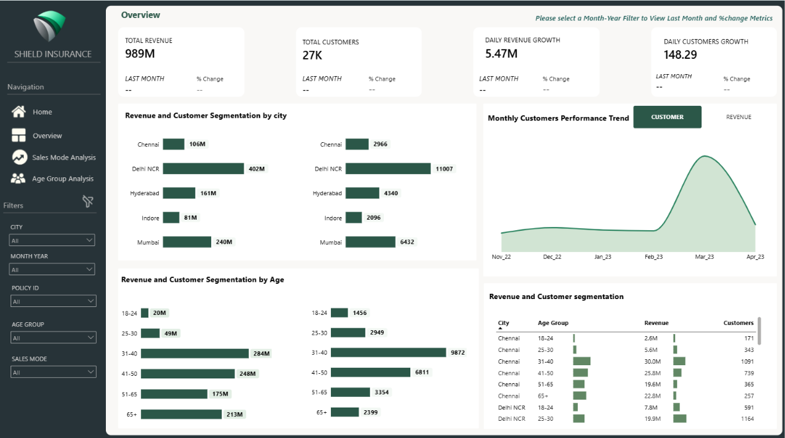
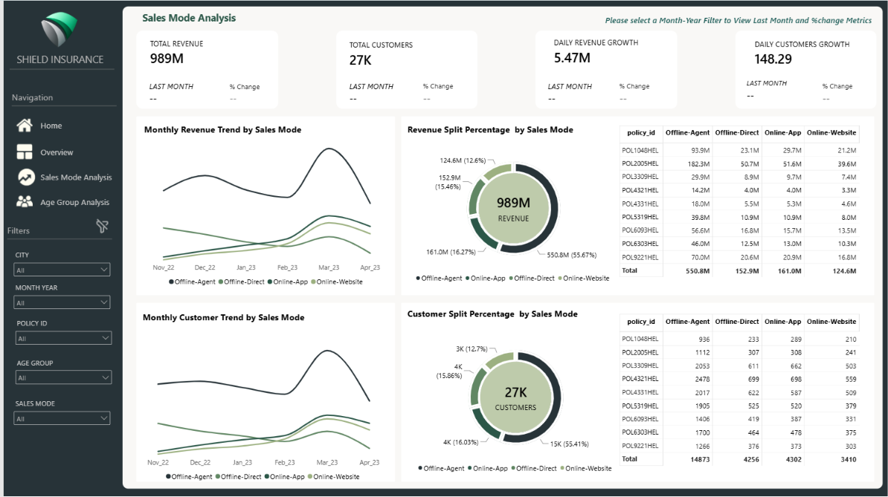
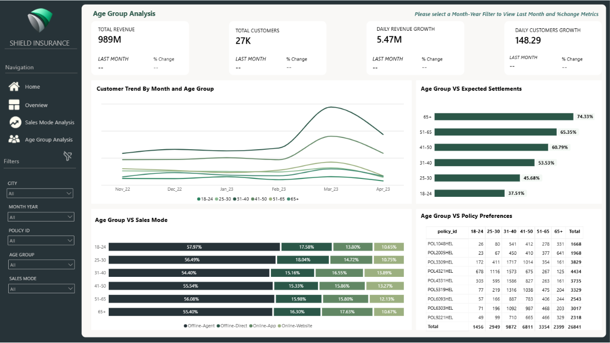

# Shield Insurance -- Business Performance & Customer Analytics

An interactive Power BI pilot dashboard designed to help Shield
Insurance understand business performance across revenue, customers,
cities, age groups, sales modes, and policy preferences.

  

# Shield Insurance – Business Performance & Customer Analytics

## Project Overview

The business requirement was to build a consolidated view of customer
and revenue performance, monitor daily growth measures and
month-over-month trends, and make it easier to explore the portfolio
through interactive filters.

The report is organised into three pages:

1.  **General Overview** -- headline KPIs, city-wise and age-wise
    revenue/customer segmentation, and a monthly trend view with a
    Customer/Revenue switch.
2.  **Sales Mode Analysis** -- monthly revenue and customer trends
    across Offline-Agent, Offline-Direct, Online-App, and
    Online-Website, with contribution analysis.
3.  **Age Group Analysis** -- expected settlements by age group,
    sales-mode mix by age group, and policy preferences by age group.

## Business Objectives

-   Monitor total revenue and total customers.
-   Track daily revenue growth and daily customer growth measures.
-   Review month-over-month business and policy trends.
-   Segment revenue and customer counts by city and age group.
-   Compare revenue and customer trends over time.
-   Analyse sales-mode contribution and monthly performance.
-   Understand expected settlements, sales-mode mix, and policy
    preferences across age groups.

## Dashboard Preview

### General Overview

### Sales Mode Analysis

### Age Group Analysis

## Key Dashboard Metrics

  Metric                     Displayed value
  ------------------------ -----------------
  Total Revenue                         989M
  Total Customers                        27K
  Daily Revenue Growth                 5.47M
  Daily Customers Growth              148.29

The Last Month and % Change fields are designed to respond to the
Month-Year filter. In the supplied dashboard screenshots, these fields
display `--` before a Month-Year selection is made.

## Key Findings from the Dashboard

### 1. City Performance

-   **Delhi NCR** leads the displayed city comparison with **402M
    revenue** and **11,007 customers**.
-   **Mumbai** ranks second with **240M revenue** and **6,432
    customers**.
-   **Hyderabad** follows with **161M revenue** and **4,340 customers**.

### 2. Age-Group Performance

-   The **31--40** age group contributes the highest displayed revenue
    at **284M** and has **9,872 customers**.
-   The **41--50** age group follows with **248M revenue** and **6,811
    customers**.
-   The 65+ age group contributes **213M revenue** and has **2,399
    customers**.

### 3. Sales-Mode Revenue Contribution

  Sales Mode         Revenue   Revenue Share
  ---------------- --------- ---------------
  Offline-Agent       550.8M          55.67%
  Online-App          161.0M          16.27%
  Offline-Direct      152.9M          15.46%
  Online-Website      124.6M          12.60%

Offline-Agent is the largest displayed revenue channel.

### 4. Sales-Mode Customer Contribution

  Sales Mode         Customers   Customer Share
  ---------------- ----------- ----------------
  Offline-Agent         14,873           55.41%
  Online-App             4,302           16.03%
  Offline-Direct         4,256           15.86%
  Online-Website         3,410           12.70%

Offline-Agent also represents the largest displayed customer segment by
sales mode.

### 5. Expected Settlements by Age Group

  Age Group     Displayed Value
  ----------- -----------------
  65+                    74.33%
  51--65                 65.35%
  41--50                 60.79%
  31--40                 53.53%
  25--30                 45.68%
  18--24                 37.51%

The dashboard shows the highest expected-settlement value for the 65+
group and the lowest for the 18--24 group. The business definition and
denominator of this measure should be validated before interpreting it
as an actual settlement or approval rate.

## Filters and Interactivity

The report includes the following slicers:

-   City
-   Month-Year
-   Policy ID
-   Age Group
-   Sales Mode

The Overview page also includes a switch to view the monthly trend by
Customer or Revenue.

## Tools & Skills

-   Microsoft Power BI
-   Power Query
-   DAX
-   Data modelling and KPI reporting
-   Interactive dashboards and data visualisation
-   Business analysis and insight communication

## Business Recommendations to Explore

These are follow-up investigation areas suggested by the displayed
patterns, not proven causes:

1.  Review the 31--50 age groups because they represent the largest
    displayed revenue and customer volumes.
2.  Explore city-level performance in Delhi NCR and Mumbai.
3.  Review operational performance and channel concentration in
    Offline-Agent.
4.  Drill into the March 2023 peak and April 2023 decline by city,
    policy, and sales mode.
5.  Validate the expected-settlement metric and investigate differences
    across age groups.

## Reporting Period

The monthly visuals in the supplied dashboard cover **November 2022 to
April 2023**.

**Ajay Pawan**\
Data Analytics \| Power BI \| SQL \| Excel
